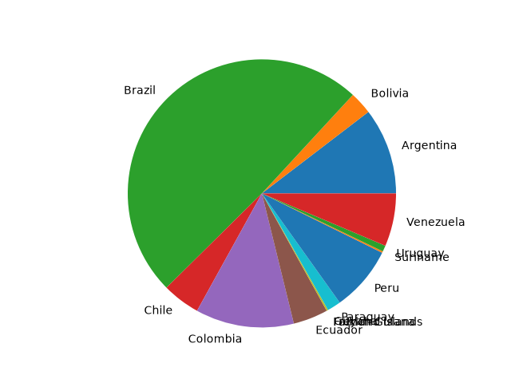
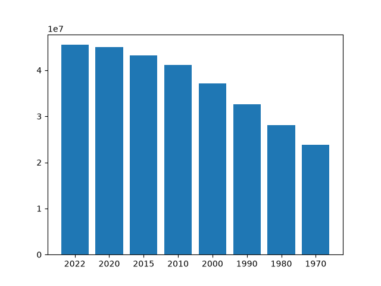

# Clase 05 – Python en Entorno Profesional (Parte 4)

Proyecto `app`: lee un CSV con la población mundial por país y genera gráficos con **matplotlib**, trabajando dentro de un **entorno virtual** (`venv`) y versionando con **git** (commits + tags).

## Estructura

| Archivo | Qué hace |
|---|---|
| `main.py` | Programa principal: filtra Sudamérica, genera la torta (`pie.png`) y pide un país para el gráfico de barras |
| `read_csv.py` | Lee `data.csv` y devuelve una lista de diccionarios (uno por país) |
| `utils.py` | `get_population()` y `population_by_country()` |
| `charts.py` | `generate_bar_chart()` y `generate_pie_chart()` – guardan PNG con `savefig` |
| `data.csv` | Datos de 234 países (población 1970–2022) |
| `requirements.txt` | Dependencias del entorno virtual |
| `imgs/` | Gráficos generados por país |

## Cómo ejecutarlo (Windows / PowerShell)

```powershell
cd app
py -m venv venv
.\venv\Scripts\Activate.ps1
pip install -r requirements.txt
python main.py        # Type Country => Argentina
deactivate
```

## Videos de la clase

| Video | Tema | Lo que hicimos |
|---|---|---|
| 11.1 | Descargar, commitear y crear el entorno virtual | `git init`, primer commit, tag `v-01-02-matplotlib2`, `py -m venv venv`, activar y `pip freeze` vacío |
| 11.2 | Instalar dependencias | `pip install matplotlib`, `pip freeze > requirements.txt` (en Windows no hace falta `apt-get`) |
| 11.3 | Archivos de la carpeta app | Recorrido de los módulos; `plt.show()` → `plt.savefig()` + `plt.close()` |
| 11.4 | Ejecución, análisis y errores | Activar el bloque `input`; `FileNotFoundError` → ruta `./data.csv`; porcentajes a `float()` (matplotlib nuevo) |
| 11.5 (1) | Mejoras | Barras guardadas en `imgs/{país}.png`; error `File name too long` por pasar el diccionario completo |
| 11.5 (2) | Ajustes y pruebas | `KeyError: 'country'` → `country['Country']`; crear carpeta `imgs` |
| 11.5 (3) | Commit final | Commit con gráficos, tag `v-01-03-csv`, `git log --graph`, `deactivate` |

## Errores encontrados y solución

- **`FileNotFoundError: './app/data.csv'`** – la ruta es relativa a donde se ejecuta; desde `app` es `./data.csv`.
- **`ufunc 'less' ... StrDType`** – el CSV devuelve texto; matplotlib 3.11 necesita números → `float(...)`.
- **`OSError: File name too long`** – se pasaba el diccionario del país como nombre de archivo → usar `country['Country']`.
- **`KeyError: 'country'`** – las claves respetan mayúsculas: la columna es `Country`.
- **`FileNotFoundError: './imgs/...'`** – `savefig` no crea carpetas → crear `imgs/`.

## Resultados

Torta de Sudamérica (`pie.png`) y barras por país:



